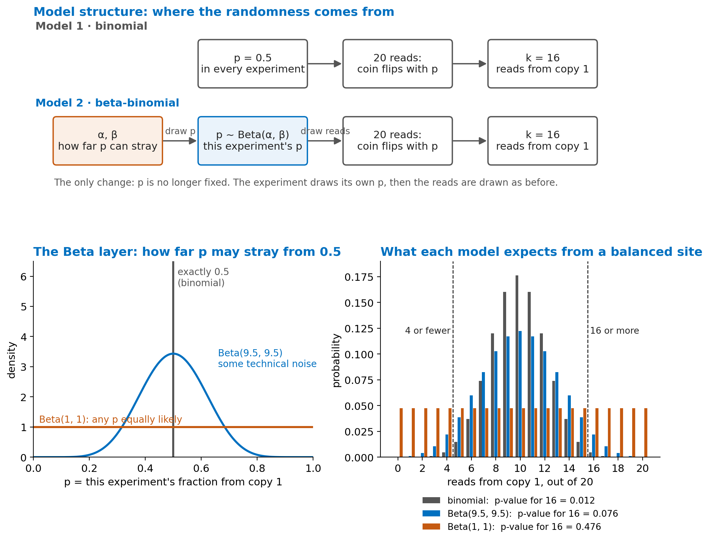

::: {.callout-important appearance="simple"}
**Rules of the lab.** **Choose one language**, Python or R, and use it for the whole lab: every exercise has both, side by side, so just follow your column. (Doing the other language too is welcome but not required.) Predict the output before you run. Use the Hint before the Solution. Write your answers to the numbered questions in your lab report — the [handout](downloads/DATA405_Lab2_Handout.pdf) has the same exercises with blanks.
:::

**Part A** follows Lecture 12 (one person, two copies, allele-specific reads). **Part B** follows Lecture 13 (many people: Hardy–Weinberg and GWAS).

| File | What | Real or simulated | Used in |
|---|---|---|---|
| — | read counts at heterozygous sites, generated in the cells | simulated | Ex 1–3 |
| `lab2/rs2814778_by_population.tsv` | genotype counts at rs2814778 (*ACKR1*, Duffy) in the five 1000 Genomes groups | **real** (1000 Genomes phase 3) | Ex 4 |
| `lab2/gwas_region.tsv`, `lab2/gwas_snps.tsv` | 2,000 people × 15 SNPs in one region, plus a trait | simulated | Ex 5 |
| `lab2/stratification.tsv` | 1,000 people from two groups, one SNP, a trait | simulated | Ex 6 |

Run both setup cells first. They load the libraries and define `two_sided()`, which turns any count distribution into a two-sided p-value: the probability of a count **at least as far from the middle** as the one observed.

::: {.two-col}
::: {}
<span class="lang-tag py">Python</span>
```{.pyodide}
import numpy as np
import pandas as pd
import matplotlib.pyplot as plt
from scipy import stats
rng = np.random.default_rng(1)

def two_sided(k, n, pmf):
    """P(count at least as far from n/2 as k), given the pmf for 0..n"""
    dist = np.abs(np.arange(n + 1) - n / 2)
    return pmf[dist >= abs(k - n / 2) - 1e-9].sum()

print("ready")
```
:::
::: {}
<span class="lang-tag r">R</span>
```{.webr}
set.seed(1)

two_sided <- function(k, n, pmf) {
  # P(count at least as far from n/2 as k), given the pmf for 0..n
  d <- abs(0:n - n / 2)
  sum(pmf[d >= abs(k - n / 2) - 1e-9])
}

# base R has no beta-binomial, so we write it from its formula
dbetabinom <- function(k, n, a, b) choose(n, k) * beta(k + a, n - k + b) / beta(a, b)

cat("ready\n")
```
:::
:::

---

# Part A · One person: reads from two copies

## Exercise 1 · Is 16 of 20 evidence of imbalance? (10 min)

A transcription factor's ChIP-seq reads cover a heterozygous site: **16 reads from copy 1, 4 from copy 2**. If the site is balanced, each read comes from copy 1 with probability 0.5. Test it, then compare three sites that all show 80 % copy 1 at different depths.

::: {.two-col}
::: {}
<span class="lang-tag py">Python</span>
```{.pyodide}
#| exercise: ex1_py
#| envir: global
for k, n in [(8, 10), (16, 20), (160, 200)]:
    r = stats.binomtest(k, n, ______)
    ci = r.proportion_ci()
    print(f"{k:>3} of {n:<3}  p = {r.pvalue:.2g}   95% CI {ci.low:.2f} - {ci.high:.2f}")
```

::: {.hint exercise="ex1_py"}
::: {.callout-tip collapse="false"}
## Hint
The null hypothesis is a balanced site: `0.5`.
:::
:::

::: {.solution exercise="ex1_py"}
```python
for k, n in [(8, 10), (16, 20), (160, 200)]:
    r = stats.binomtest(k, n, 0.5)
    ci = r.proportion_ci()
    print(f"{k:>3} of {n:<3}  p = {r.pvalue:.2g}   95% CI {ci.low:.2f} - {ci.high:.2f}")
#   8 of 10   p = 0.11      95% CI 0.44 - 0.97
#  16 of 20   p = 0.012     95% CI 0.56 - 0.94
# 160 of 200  p = 3.4e-18   95% CI 0.74 - 0.85
```
:::
:::
::: {}
<span class="lang-tag r">R</span>
```{.webr}
#| exercise: ex1_r
#| envir: global
for (x in list(c(8, 10), c(16, 20), c(160, 200))) {
  r <- binom.test(x[1], x[2], p = ______)
  cat(x[1], "of", x[2], " p =", signif(r$p.value, 2),
      "  95% CI", round(r$conf.int, 2), "\n")
}
```

::: {.hint exercise="ex1_r"}
::: {.callout-tip collapse="false"}
## Hint
The null hypothesis is a balanced site: `p = 0.5`.
:::
:::

::: {.solution exercise="ex1_r"}
```r
for (x in list(c(8, 10), c(16, 20), c(160, 200))) {
  r <- binom.test(x[1], x[2], p = 0.5)
  cat(x[1], "of", x[2], " p =", signif(r$p.value, 2),
      "  95% CI", round(r$conf.int, 2), "\n")
}
# 8 of 10    p = 0.11     95% CI 0.44 0.97
# 16 of 20   p = 0.012    95% CI 0.56 0.94
# 160 of 200 p = 3.4e-18  95% CI 0.74 0.85
```
:::
:::
:::

::: {.checkpoint}
Same ratio, different evidence. Only 8 of 10 has an interval that still contains 0.5.
:::

**Q1.** Why does 8 of 10 fail the test while 160 of 200, with the same 80 %, gives p = 3.4 × 10⁻¹⁸? Answer with the width of the 95 % interval.

## Exercise 2 · One person, 100,000 tests (10 min)

A person has about 100,000 well-covered heterozygous sites. Suppose **every one is balanced** and each has 30 reads. How many still pass p < 0.05?

All sites have the same depth, so there are only 31 possible counts (0 to 30) and 31 possible p-values. We compute them once in a table and look each site up.

::: {.two-col}
::: {}
<span class="lang-tag py">Python</span>
```{.pyodide}
#| exercise: ex2_py
#| envir: global
n, m = 30, 100_000
k = rng.binomial(n, 0.5, size=m)            # copy-1 reads at every site
pmf = stats.binom.pmf(np.arange(n + 1), n, 0.5)
p_table = np.array([two_sided(x, n, pmf) for x in range(n + 1)])
p = p_table[k]                              # look up each site's p-value
print("p < 0.05:        ", (p < ______).sum())
print("Bonferroni line: ", 0.05 / m, "->", (p < 0.05 / m).sum(), "sites")
```

::: {.hint exercise="ex2_py"}
::: {.callout-tip collapse="false"}
## Hint
`0.05`. Bonferroni divides 0.05 by the number of tests.
:::
:::

::: {.solution exercise="ex2_py"}
```python
n, m = 30, 100_000
k = rng.binomial(n, 0.5, size=m)
pmf = stats.binom.pmf(np.arange(n + 1), n, 0.5)
p_table = np.array([two_sided(x, n, pmf) for x in range(n + 1)])
p = p_table[k]
print("p < 0.05:        ", (p < 0.05).sum())          # about 4,300-4,400
print("Bonferroni line: ", 0.05 / m, "->", (p < 0.05 / m).sum(), "sites")   # 0
```
:::
:::
::: {}
<span class="lang-tag r">R</span>
```{.webr}
#| exercise: ex2_r
#| envir: global
n <- 30; m <- 100000
k <- rbinom(m, n, 0.5)                      # copy-1 reads at every site
pmf <- dbinom(0:n, n, 0.5)
p_table <- sapply(0:n, function(x) two_sided(x, n, pmf))
p <- p_table[k + 1]                         # R counts from 1, so count 0 is entry 1
cat("p < 0.05:        ", sum(p < ______), "\n")
cat("Bonferroni line: ", 0.05 / m, "->", sum(p < 0.05 / m), "sites\n")
```

::: {.hint exercise="ex2_r"}
::: {.callout-tip collapse="false"}
## Hint
`0.05`. Note `p_table[k + 1]`: R vectors start at position 1.
:::
:::

::: {.solution exercise="ex2_r"}
```r
n <- 30; m <- 100000
k <- rbinom(m, n, 0.5)
pmf <- dbinom(0:n, n, 0.5)
p_table <- sapply(0:n, function(x) two_sided(x, n, pmf))
p <- p_table[k + 1]
cat("p < 0.05:        ", sum(p < 0.05), "\n")             # about 4,300-4,400
cat("Bonferroni line: ", 0.05 / m, "->", sum(p < 0.05 / m), "sites\n")   # 0
```
:::
:::
:::

::: {.checkpoint}
About **4,300–4,400** balanced sites pass p < 0.05, all false. None passes the Bonferroni line of 5 × 10⁻⁷. (The exact count changes from run to run, and Python and R draw different random numbers.)
:::

**Q2.** Why is the count a little *below* 5 % of 100,000? (Look at `p_table`: can a count of 30 reads give a p-value of exactly 0.05?)

## Exercise 3 · A balanced site that looks imbalanced (25 min)

The story, one site at a time:

1. **The truth.** The factor binds both copies equally: 50 / 50.
2. **A technical factor tips the balance.** During library preparation, PCR happens to copy fragments from copy 1 more often. The 20 reads now come from a pool that is **75 %** copy 1.
3. **The data.** We see 16 reads from copy 1 and 4 from copy 2.
4. **The binomial test** (Exercise 1) says p = 0.012: "significant". The conclusion is wrong: the imbalance came from the experiment, not the biology.

### 3a · How ordinary is 16 of 20 from a 75 % pool?

::: {.two-col}
::: {}
<span class="lang-tag py">Python</span>
```{.pyodide}
print("P(16 or more | pool 75%) =", round(stats.binom.sf(15, 20, 0.75), 3))
print("binomial test, p = 0.5:  ", round(stats.binomtest(16, 20, 0.5).pvalue, 4))
```
:::
::: {}
<span class="lang-tag r">R</span>
```{.webr}
cat("P(16 or more | pool 75%) =", round(1 - pbinom(15, 20, 0.75), 3), "\n")
cat("binomial test, p = 0.5:  ", round(binom.test(16, 20, 0.5)$p.value, 4), "\n")
```
:::
:::

Under the pool the experiment actually made, 16 or more happens **41 %** of the time. The binomial test is fooled because it assumes p is *exactly* 0.5 in every experiment.

### 3b · Add a layer: let p stray, by an amount we do not know

We keep the coin flips, but we stop fixing p. Each experiment draws its own p from a **Beta(α, β)** distribution, and then the reads are drawn as before. This two-layer model is the **beta-binomial**.

{width=100%}

**What α and β mean.** Think of them as *imaginary reads* we hold in mind before seeing any data: α from copy 1 and β from copy 2.

- **Their ratio sets the centre.** The average p is α / (α + β). Setting α = β keeps the centre at 0.5: the biology is balanced.
- **Their sum sets how sure we are.** A large α + β gives a narrow Beta, so p stays near 0.5. A small sum gives a wide Beta, so p can stray far.

| Choice | What it says | Typical spread of p (SD) |
|---|---|---|
| p exactly 0.5 (binomial) | no technical noise | 0 |
| Beta(50, 50) | very little noise | 0.05 |
| Beta(9.5, 9.5) | some technical noise | 0.11 |
| Beta(1, 1) | no idea: any p equally likely | 0.29 |

Draw the Beta curves yourself. Change α and β, then run again.

::: {.two-col}
::: {}
<span class="lang-tag py">Python</span>
```{.pyodide}
#| exercise: ex3b_py
#| envir: global
x = np.linspace(0.001, 0.999, 400)
fig, ax = plt.subplots(figsize=(4, 2.8))
for a in [50, 9.5, ______]:
    ax.plot(x, stats.beta.pdf(x, a, a), label=f"Beta({a}, {a})")
ax.set_xlabel("p, this experiment's fraction from copy 1"); ax.set_ylabel("density")
ax.legend(frameon=False, fontsize=8); plt.tight_layout(); plt.show()
for a in [50, 9.5, 1]:
    print(f"Beta({a}, {a}): SD of p = {stats.beta.std(a, a):.3f}")
```

::: {.hint exercise="ex3b_py"}
::: {.callout-tip collapse="false"}
## Hint
The flat Beta is `1`.
:::
:::

::: {.solution exercise="ex3b_py"}
```python
x = np.linspace(0.001, 0.999, 400)
fig, ax = plt.subplots(figsize=(4, 2.8))
for a in [50, 9.5, 1]:
    ax.plot(x, stats.beta.pdf(x, a, a), label=f"Beta({a}, {a})")
ax.set_xlabel("p, this experiment's fraction from copy 1"); ax.set_ylabel("density")
ax.legend(frameon=False, fontsize=8); plt.tight_layout(); plt.show()
for a in [50, 9.5, 1]:
    print(f"Beta({a}, {a}): SD of p = {stats.beta.std(a, a):.3f}")   # 0.050, 0.112, 0.289
```
:::
:::
::: {}
<span class="lang-tag r">R</span>
```{.webr}
#| exercise: ex3b_r
#| envir: global
#| fig-width: 4
#| fig-height: 2.8
x <- seq(0.001, 0.999, length.out = 400)
par(mar = c(4, 4, 1, 1))
plot(x, dbeta(x, 50, 50), type = "l", ylim = c(0, 8),
     xlab = "p, this experiment's fraction from copy 1", ylab = "density")
lines(x, dbeta(x, 9.5, 9.5), col = "blue")
lines(x, dbeta(x, ______, ______), col = "orange")
sd_beta <- function(a) sqrt(a * a / ((2 * a)^2 * (2 * a + 1)))
cat("SD of p:", round(sapply(c(50, 9.5, 1), sd_beta), 3), "\n")
```

::: {.hint exercise="ex3b_r"}
::: {.callout-tip collapse="false"}
## Hint
The flat Beta is `dbeta(x, 1, 1)`.
:::
:::

::: {.solution exercise="ex3b_r"}
```r
x <- seq(0.001, 0.999, length.out = 400)
par(mar = c(4, 4, 1, 1))
plot(x, dbeta(x, 50, 50), type = "l", ylim = c(0, 8),
     xlab = "p, this experiment's fraction from copy 1", ylab = "density")
lines(x, dbeta(x, 9.5, 9.5), col = "blue")
lines(x, dbeta(x, 1, 1), col = "orange")
sd_beta <- function(a) sqrt(a * a / ((2 * a)^2 * (2 * a + 1)))
cat("SD of p:", round(sapply(c(50, 9.5, 1), sd_beta), 3), "\n")   # 0.050 0.112 0.289
```
:::
:::
:::

### 3c · Test 16 of 20 again, now allowing p to stray

Use the beta-binomial distribution of counts in place of the binomial, and compute the same two-sided p-value.

::: {.two-col}
::: {}
<span class="lang-tag py">Python</span>
```{.pyodide}
#| exercise: ex3c_py
#| envir: global
n, k = 20, 16
counts = np.arange(n + 1)
print("binomial        p =", round(two_sided(k, n, stats.binom.pmf(counts, n, 0.5)), 3))
for a in [50, 9.5, 1]:
    pmf = stats.betabinom.pmf(counts, n, a, ______)
    print(f"Beta({a}, {a})".ljust(15), "p =", round(two_sided(k, n, pmf), 3))
```

::: {.hint exercise="ex3c_py"}
::: {.callout-tip collapse="false"}
## Hint
α = β, so the fourth argument is `a` again.
:::
:::

::: {.solution exercise="ex3c_py"}
```python
n, k = 20, 16
counts = np.arange(n + 1)
print("binomial        p =", round(two_sided(k, n, stats.binom.pmf(counts, n, 0.5)), 3))
for a in [50, 9.5, 1]:
    pmf = stats.betabinom.pmf(counts, n, a, a)
    print(f"Beta({a}, {a})".ljust(15), "p =", round(two_sided(k, n, pmf), 3))
# binomial 0.012 · Beta(50, 50) 0.021 · Beta(9.5, 9.5) 0.076 · Beta(1, 1) 0.476
```
:::
:::
::: {}
<span class="lang-tag r">R</span>
```{.webr}
#| exercise: ex3c_r
#| envir: global
n <- 20; k <- 16
cat("binomial        p =", round(two_sided(k, n, dbinom(0:n, n, 0.5)), 3), "\n")
for (a in c(50, 9.5, 1)) {
  pmf <- dbetabinom(0:n, n, a, ______)
  cat("Beta(", a, ",", a, ")  p =", round(two_sided(k, n, pmf), 3), "\n")
}
```

::: {.hint exercise="ex3c_r"}
::: {.callout-tip collapse="false"}
## Hint
α = β, so the last argument is `a` again.
:::
:::

::: {.solution exercise="ex3c_r"}
```r
n <- 20; k <- 16
cat("binomial        p =", round(two_sided(k, n, dbinom(0:n, n, 0.5)), 3), "\n")
for (a in c(50, 9.5, 1)) {
  pmf <- dbetabinom(0:n, n, a, a)
  cat("Beta(", a, ",", a, ")  p =", round(two_sided(k, n, pmf), 3), "\n")
}
# binomial 0.012 · Beta(50, 50) 0.021 · Beta(9.5, 9.5) 0.076 · Beta(1, 1) 0.476
```
:::
:::
:::

::: {.checkpoint}
With some technical noise allowed for (Beta(9.5, 9.5)), 16 of 20 is **not** significant (p = 0.076). Allow too much (Beta(1, 1)) and nothing can ever be called (p = 0.48).
:::

### 3d · From one site to many

Every heterozygous site in a dataset goes through the same library preparation, so each one gets its own random push. Simulate 10,000 balanced sites this way: draw each site's p from Beta(9.5, 9.5), then draw 20 reads. Test every site with both models.

::: {.two-col}
::: {}
<span class="lang-tag py">Python</span>
```{.pyodide}
#| exercise: ex3d_py
#| envir: global
n, m, a = 20, 10_000, 9.5
p_site = rng.beta(a, a, size=m)              # layer 1: the experiment sets each site's p
k = rng.binomial(n, ______)                  # layer 2: the reads
counts = np.arange(n + 1)
p_binom = np.array([two_sided(x, n, stats.binom.pmf(counts, n, 0.5)) for x in counts])[k]
p_bb    = np.array([two_sided(x, n, stats.betabinom.pmf(counts, n, a, a)) for x in counts])[k]
print("balanced sites called significant (p < 0.05)")
print("  binomial:     ", round((p_binom < 0.05).mean() * 100, 1), "%")
print("  beta-binomial:", round((p_bb < 0.05).mean() * 100, 1), "%")
```

::: {.hint exercise="ex3d_py"}
::: {.callout-tip collapse="false"}
## Hint
Each site uses its own p: `p_site`.
:::
:::

::: {.solution exercise="ex3d_py"}
```python
n, m, a = 20, 10_000, 9.5
p_site = rng.beta(a, a, size=m)
k = rng.binomial(n, p_site)
counts = np.arange(n + 1)
p_binom = np.array([two_sided(x, n, stats.binom.pmf(counts, n, 0.5)) for x in counts])[k]
p_bb    = np.array([two_sided(x, n, stats.betabinom.pmf(counts, n, a, a)) for x in counts])[k]
print("balanced sites called significant (p < 0.05)")
print("  binomial:     ", round((p_binom < 0.05).mean() * 100, 1), "%")   # about 15 %
print("  beta-binomial:", round((p_bb < 0.05).mean() * 100, 1), "%")      # about 3 %
```
:::
:::
::: {}
<span class="lang-tag r">R</span>
```{.webr}
#| exercise: ex3d_r
#| envir: global
n <- 20; m <- 10000; a <- 9.5
p_site <- rbeta(m, a, a)                     # layer 1: the experiment sets each site's p
k <- rbinom(m, n, ______)                    # layer 2: the reads
tab_binom <- sapply(0:n, function(x) two_sided(x, n, dbinom(0:n, n, 0.5)))
tab_bb    <- sapply(0:n, function(x) two_sided(x, n, dbetabinom(0:n, n, a, a)))
cat("balanced sites called significant (p < 0.05)\n")
cat("  binomial:     ", round(mean(tab_binom[k + 1] < 0.05) * 100, 1), "%\n")
cat("  beta-binomial:", round(mean(tab_bb[k + 1] < 0.05) * 100, 1), "%\n")
```

::: {.hint exercise="ex3d_r"}
::: {.callout-tip collapse="false"}
## Hint
Each site uses its own p: `p_site`.
:::
:::

::: {.solution exercise="ex3d_r"}
```r
n <- 20; m <- 10000; a <- 9.5
p_site <- rbeta(m, a, a)
k <- rbinom(m, n, p_site)
tab_binom <- sapply(0:n, function(x) two_sided(x, n, dbinom(0:n, n, 0.5)))
tab_bb    <- sapply(0:n, function(x) two_sided(x, n, dbetabinom(0:n, n, a, a)))
cat("balanced sites called significant (p < 0.05)\n")
cat("  binomial:     ", round(mean(tab_binom[k + 1] < 0.05) * 100, 1), "%\n")   # about 15 %
cat("  beta-binomial:", round(mean(tab_bb[k + 1] < 0.05) * 100, 1), "%\n")      # about 3 %
```
:::
:::
:::

::: {.checkpoint}
All 10,000 sites are balanced. The binomial calls about **15 %** of them significant; the beta-binomial about **3 %**, below the 5 % a correct test promises.
:::

**Q3.** In 3c you had to *choose* α and β. In real data we cannot repeat one site's experiment many times, so one site gives a single count. Explain in two sentences why α and β are estimated from **all** heterozygous sites of a dataset together, and why that works (think of 3d).

---

# Part B · Many people: the 1000 Genomes Project

## Exercise 4 · Hardy–Weinberg at rs2814778 (15 min)

rs2814778 (*ACKR1*, the Duffy blood group) has alleles T (frequency p) and C (frequency q = 1 − p). These are the **real** genotype counts in the 2,504 people of 1000 Genomes, by continental group. Lecture 13 showed that the whole cohort fails Hardy–Weinberg badly. Test each group on its own.

::: {.two-col}
::: {}
<span class="lang-tag py">Python</span>
```{.pyodide}
#| exercise: ex4_py
#| envir: global
pops = pd.read_csv("data/lab2/rs2814778_by_population.tsv", sep="\t")

def hwe(TT, CT, CC):
    n = TT + CT + CC
    p = (2 * TT + CT) / (2 * n)              # frequency of T
    q = 1 - p
    expected = n * np.array([p**2, ______, q**2])
    observed = np.array([TT, CT, CC])
    keep = expected > 0                      # a missing allele gives nothing to test
    chi2 = (((observed - expected) ** 2 / np.where(keep, expected, 1))[keep]).sum()
    return round(p, 3), np.round(expected, 1), round(chi2, 1), stats.chi2.sf(chi2, df=1)

print("ALL", hwe(*pops[["TT", "CT", "CC"]].sum()))
for _, r in pops.iterrows():
    print(r["population"], hwe(r["TT"], r["CT"], r["CC"]))
```

::: {.hint exercise="ex4_py"}
::: {.callout-tip collapse="false"}
## Hint
Heterozygotes are expected at frequency `2 * p * q`.
:::
:::

::: {.solution exercise="ex4_py"}
```python
pops = pd.read_csv("data/lab2/rs2814778_by_population.tsv", sep="\t")

def hwe(TT, CT, CC):
    n = TT + CT + CC
    p = (2 * TT + CT) / (2 * n)
    q = 1 - p
    expected = n * np.array([p**2, 2 * p * q, q**2])
    observed = np.array([TT, CT, CC])
    keep = expected > 0
    chi2 = (((observed - expected) ** 2 / np.where(keep, expected, 1))[keep]).sum()
    return round(p, 3), np.round(expected, 1), round(chi2, 1), stats.chi2.sf(chi2, df=1)

print("ALL", hwe(*pops[["TT", "CT", "CC"]].sum()))
for _, r in pops.iterrows():
    print(r["population"], hwe(r["TT"], r["CT"], r["CC"]))
# ALL chi2 2073.9 · AFR 12.1 (p = 5e-4) · AMR 8.5 · EAS 0 · EUR 0.0 · SAS 0
```
:::
:::
::: {}
<span class="lang-tag r">R</span>
```{.webr}
#| exercise: ex4_r
#| envir: global
pops <- read.delim("data/lab2/rs2814778_by_population.tsv")

hwe <- function(TT, CT, CC) {
  n <- TT + CT + CC
  p <- (2 * TT + CT) / (2 * n)               # frequency of T
  q <- 1 - p
  expected <- n * c(p^2, ______, q^2)
  observed <- c(TT, CT, CC)
  keep <- expected > 0                       # a missing allele gives nothing to test
  chi2 <- sum(((observed - expected)^2 / expected)[keep])
  c(p = round(p, 3), round(expected, 1), chi2 = round(chi2, 1),
    pvalue = signif(pchisq(chi2, df = 1, lower.tail = FALSE), 2))
}

hwe(sum(pops$TT), sum(pops$CT), sum(pops$CC))
by_group <- t(sapply(1:nrow(pops), function(i) hwe(pops$TT[i], pops$CT[i], pops$CC[i])))
rownames(by_group) <- pops$population
by_group
```

::: {.hint exercise="ex4_r"}
::: {.callout-tip collapse="false"}
## Hint
Heterozygotes are expected at frequency `2 * p * q`.
:::
:::

::: {.solution exercise="ex4_r"}
```r
pops <- read.delim("data/lab2/rs2814778_by_population.tsv")

hwe <- function(TT, CT, CC) {
  n <- TT + CT + CC
  p <- (2 * TT + CT) / (2 * n)
  q <- 1 - p
  expected <- n * c(p^2, 2 * p * q, q^2)
  observed <- c(TT, CT, CC)
  keep <- expected > 0
  chi2 <- sum(((observed - expected)^2 / expected)[keep])
  c(p = round(p, 3), round(expected, 1), chi2 = round(chi2, 1),
    pvalue = signif(pchisq(chi2, df = 1, lower.tail = FALSE), 2))
}

hwe(sum(pops$TT), sum(pops$CT), sum(pops$CC))
by_group <- t(sapply(1:nrow(pops), function(i) hwe(pops$TT[i], pops$CT[i], pops$CC[i])))
rownames(by_group) <- pops$population
by_group
# rows: AFR, AMR, EAS, EUR, SAS · chi2 12.1, 8.5, 0, 0.0, 0
```
:::
:::
:::

::: {.checkpoint}
Pooled: χ² = **2,074**. Within groups the failure shrinks to χ² = 12.1 (AFR) and 8.5 (AMR); EUR fits (χ² ≈ 0). In EAS and SAS everyone is TT, so there is nothing to test.
:::

**Q4.** Splitting by group removed almost all of the failure. Why do AFR and AMR still fail a little? (Hint: each of these continental groups combines several populations, some of them of recently mixed ancestry, such as African Americans in the southwest US (ASW) and Puerto Ricans (PUR).)

## Exercise 5 · A GWAS of one region (15 min)

`gwas_region.tsv` has 2,000 people, 15 SNPs spread over 190 kb, and a trait. Run the GWAS regression at every SNP: trait = a + β × genotype. Compute z = β / SE, the p-value, and draw the region with the genome-wide line at 5 × 10⁻⁸.

::: {.two-col}
::: {}
<span class="lang-tag py">Python</span>
```{.pyodide}
#| exercise: ex5_py
#| envir: global
gw   = pd.read_csv("data/lab2/gwas_region.tsv", sep="\t")
snps = pd.read_csv("data/lab2/gwas_snps.tsv", sep="\t")
rows = []
for s in snps["snp"]:
    fit = stats.linregress(gw[s], gw["trait"])
    z = fit.slope / ______
    rows.append([s, round(fit.slope, 3), round(fit.stderr, 4), round(z, 2), fit.pvalue])
res = pd.DataFrame(rows, columns=["snp", "beta", "se", "z", "p"])
res["position"] = snps["position"]
print(res.to_string(index=False))

fig, ax = plt.subplots(figsize=(4.5, 2.8))
ax.scatter(res["position"] / 1e6, -np.log10(res["p"]))
ax.axhline(-np.log10(5e-8), color="red", ls="--")
ax.set_xlabel("position (Mb)"); ax.set_ylabel("-log10 p")
plt.tight_layout(); plt.show()
```

::: {.hint exercise="ex5_py"}
::: {.callout-tip collapse="false"}
## Hint
z is the slope divided by its standard error: `fit.stderr`.
:::
:::

::: {.solution exercise="ex5_py"}
```python
gw   = pd.read_csv("data/lab2/gwas_region.tsv", sep="\t")
snps = pd.read_csv("data/lab2/gwas_snps.tsv", sep="\t")
rows = []
for s in snps["snp"]:
    fit = stats.linregress(gw[s], gw["trait"])
    z = fit.slope / fit.stderr
    rows.append([s, round(fit.slope, 3), round(fit.stderr, 4), round(z, 2), fit.pvalue])
res = pd.DataFrame(rows, columns=["snp", "beta", "se", "z", "p"])
res["position"] = snps["position"]
print(res.to_string(index=False))
# lead: snp8, beta 0.261, SE 0.0338, z 7.72, p 1.8e-14
# snp6, snp7, snp9, snp10 also pass 5e-8; snp12 and snp14 have p = 0.04

fig, ax = plt.subplots(figsize=(4.5, 2.8))
ax.scatter(res["position"] / 1e6, -np.log10(res["p"]))
ax.axhline(-np.log10(5e-8), color="red", ls="--")
ax.set_xlabel("position (Mb)"); ax.set_ylabel("-log10 p")
plt.tight_layout(); plt.show()
```
:::
:::
::: {}
<span class="lang-tag r">R</span>
```{.webr}
#| exercise: ex5_r
#| envir: global
#| fig-width: 4.5
#| fig-height: 2.8
gw   <- read.delim("data/lab2/gwas_region.tsv")
snps <- read.delim("data/lab2/gwas_snps.tsv")
res <- t(sapply(snps$snp, function(s) {
  co <- summary(lm(gw$trait ~ gw[[s]]))$coefficients[2, ]
  c(beta = co[["Estimate"]], se = co[["Std. Error"]],
    z = co[["Estimate"]] / ______, p = co[["Pr(>|t|)"]])
}))
res <- data.frame(res, position = snps$position)
print(cbind(signif(res[, 1:4], 3), position = res$position))

par(mar = c(4, 4, 1, 1))
plot(res$position / 1e6, -log10(res$p), pch = 19,
     xlab = "position (Mb)", ylab = "-log10 p")
abline(h = -log10(5e-8), col = "red", lty = 2)
```

::: {.hint exercise="ex5_r"}
::: {.callout-tip collapse="false"}
## Hint
z is the slope divided by its standard error: `co[["Std. Error"]]`.
:::
:::

::: {.solution exercise="ex5_r"}
```r
gw   <- read.delim("data/lab2/gwas_region.tsv")
snps <- read.delim("data/lab2/gwas_snps.tsv")
res <- t(sapply(snps$snp, function(s) {
  co <- summary(lm(gw$trait ~ gw[[s]]))$coefficients[2, ]
  c(beta = co[["Estimate"]], se = co[["Std. Error"]],
    z = co[["Estimate"]] / co[["Std. Error"]], p = co[["Pr(>|t|)"]])
}))
res <- data.frame(res, position = snps$position)
print(cbind(signif(res[, 1:4], 3), position = res$position))
# lead: snp8, beta 0.261, SE 0.0338, z 7.72, p 1.8e-14

par(mar = c(4, 4, 1, 1))
plot(res$position / 1e6, -log10(res$p), pch = 19,
     xlab = "position (Mb)", ylab = "-log10 p")
abline(h = -log10(5e-8), col = "red", lty = 2)
```
:::
:::
:::

Now measure linkage: r² between the lead SNP and every other SNP is the squared correlation of their genotype columns.

::: {.two-col}
::: {}
<span class="lang-tag py">Python</span>
```{.pyodide}
lead = res.loc[res["p"].idxmin(), "snp"]
res["r2_with_lead"] = [round(np.corrcoef(gw[s], gw[lead])[0, 1] ** 2, 2) for s in res["snp"]]
print("lead SNP:", lead)
print(res[["snp", "p", "r2_with_lead"]].to_string(index=False))
```
:::
::: {}
<span class="lang-tag r">R</span>
```{.webr}
lead <- rownames(res)[which.min(res$p)]
res$r2_with_lead <- round(sapply(snps$snp, function(s) cor(gw[[s]], gw[[lead]])^2), 2)
cat("lead SNP:", lead, "\n")
res[, c("p", "r2_with_lead")]
```
:::
:::

::: {.checkpoint}
Five neighbouring SNPs (snp6–snp10) pass 5 × 10⁻⁸; their r² with snp8 is 0.57–0.93. In this simulation only **snp8** affects the trait. Two SNPs in another block have p ≈ 0.04: below 0.05, far above the genome-wide line.
:::

**Q5.** (a) From the results alone, could you tell which of snp6–snp10 is the causal one? Why or why not? (b) Why is p = 0.04 at snp12 not a finding in a GWAS?

## Exercise 6 · Group differences create a false hit (10 min)

`stratification.tsv`: 1,000 people from two groups. The allele frequency is about 0.2 in group 1 and 0.7 in group 2, and the trait is higher in group 2 for a non-genetic reason. **The SNP has no effect on the trait.** Run the GWAS regression without, then with, the group in the model.

::: {.two-col}
::: {}
<span class="lang-tag py">Python</span>
```{.pyodide}
#| exercise: ex6_py
#| envir: global
st = pd.read_csv("data/lab2/stratification.tsv", sep="\t")
print(st.groupby("group").agg(freq=("genotype", lambda g: g.mean() / 2),
                              mean_trait=("trait", "mean")))

def ols(columns, y):
    """least squares; returns beta, SE and p for every column after the intercept"""
    X = np.column_stack([np.ones(len(y))] + columns)
    beta, *_ = np.linalg.lstsq(X, y, rcond=None)
    resid = y - X @ beta
    df = len(y) - X.shape[1]
    se = np.sqrt(np.diag(resid @ resid / df * np.linalg.inv(X.T @ X)))
    p = 2 * stats.t.sf(np.abs(beta / se), df)
    return np.round(beta[1:], 3), np.round(se[1:], 4), p[1:]

g = st["genotype"].to_numpy(float)
y = st["trait"].to_numpy()
in_group2 = (st["group"] == 2).to_numpy(float)
print("trait ~ genotype:         ", ols([g], y))
print("trait ~ genotype + group: ", ols([g, ______], y))
```

::: {.hint exercise="ex6_py"}
::: {.callout-tip collapse="false"}
## Hint
Add the group indicator `in_group2` as a second column.
:::
:::

::: {.solution exercise="ex6_py"}
```python
st = pd.read_csv("data/lab2/stratification.tsv", sep="\t")
print(st.groupby("group").agg(freq=("genotype", lambda g: g.mean() / 2),
                              mean_trait=("trait", "mean")))

def ols(columns, y):
    """least squares; returns beta, SE and p for every column after the intercept"""
    X = np.column_stack([np.ones(len(y))] + columns)
    beta, *_ = np.linalg.lstsq(X, y, rcond=None)
    resid = y - X @ beta
    df = len(y) - X.shape[1]
    se = np.sqrt(np.diag(resid @ resid / df * np.linalg.inv(X.T @ X)))
    p = 2 * stats.t.sf(np.abs(beta / se), df)
    return np.round(beta[1:], 3), np.round(se[1:], 4), p[1:]

g = st["genotype"].to_numpy(float)
y = st["trait"].to_numpy()
in_group2 = (st["group"] == 2).to_numpy(float)
print("trait ~ genotype:         ", ols([g], y))
print("trait ~ genotype + group: ", ols([g, in_group2], y))
# genotype only: beta 0.373, p 3e-18
# with group:    beta 0.061, p 0.25   (group effect 0.768)
```
:::
:::
::: {}
<span class="lang-tag r">R</span>
```{.webr}
#| exercise: ex6_r
#| envir: global
st <- read.delim("data/lab2/stratification.tsv")
print(aggregate(cbind(freq = genotype / 2, trait) ~ group, data = st, FUN = mean))

m1 <- lm(trait ~ genotype, data = st)
m2 <- lm(trait ~ genotype + ______, data = st)
summary(m1)$coefficients["genotype", ]
summary(m2)$coefficients["genotype", ]
```

::: {.hint exercise="ex6_r"}
::: {.callout-tip collapse="false"}
## Hint
`factor(group)` tells R the group is a category, not a number.
:::
:::

::: {.solution exercise="ex6_r"}
```r
st <- read.delim("data/lab2/stratification.tsv")
print(aggregate(cbind(freq = genotype / 2, trait) ~ group, data = st, FUN = mean))
m1 <- lm(trait ~ genotype, data = st)
m2 <- lm(trait ~ genotype + factor(group), data = st)
summary(m1)$coefficients["genotype", ]   # beta 0.373, p 3e-18
summary(m2)$coefficients["genotype", ]   # beta 0.061, p 0.25
```
:::
:::
:::

::: {.checkpoint}
Without the group: β = **0.373**, p = 3 × 10⁻¹⁸, a "genome-wide hit" for a SNP that does nothing. With the group in the model: β = **0.061**, p = 0.25.
:::

**Q6.** Explain in your own words why the SNP looked associated with the trait. In a real GWAS, people do not come labelled with a group: what do studies put in the model instead? (Lecture 13.)

**Q7.** Exercise 3 and Exercise 6 have the same shape: a hidden factor makes an ordinary test too confident, and the fix adds that factor to the model. Name the hidden factor and the fix in each.

---

## Lab report (submit by Tuesday, Oct 20)

Answers to **Q1–Q7**, plus two figures: the Beta curves from 3b with one choice of your own added, and the regional plot from Exercise 5. One to two pages.
