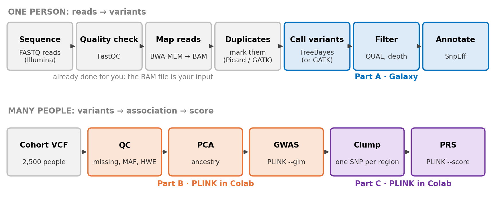
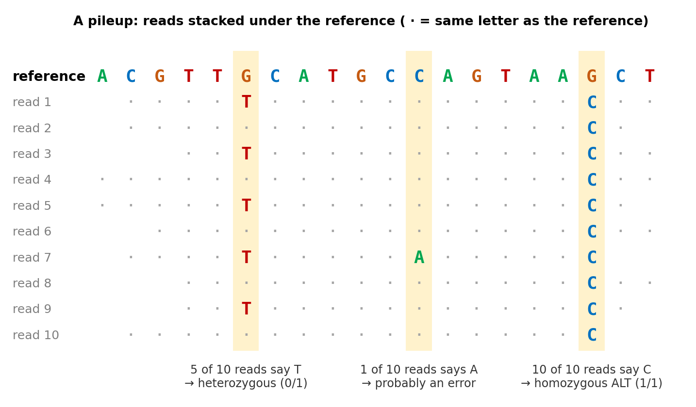
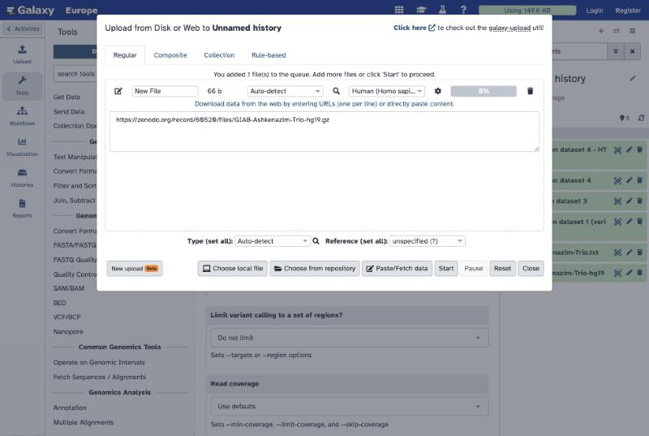
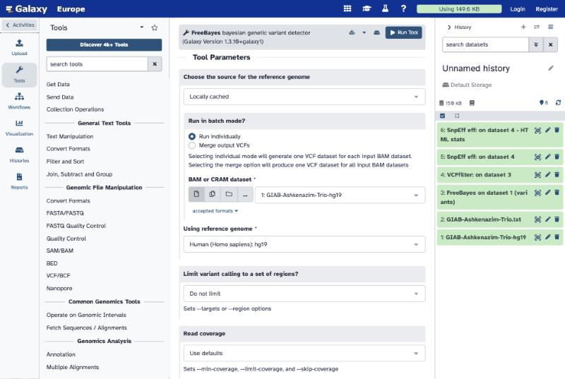
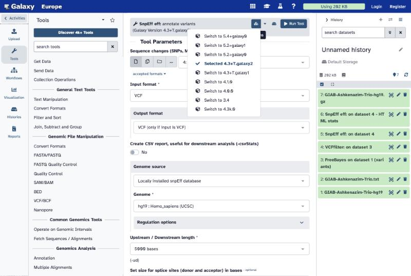
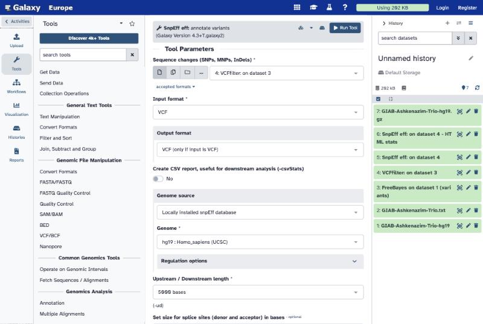

::: {.callout-important appearance="simple"}
**Today you run real pipelines with the tools research labs and hospitals use.** Part A runs in **Galaxy** (a website that runs bioinformatics tools). Parts B and C run **PLINK 2** in **Google Colab**, in a Python *or* an R notebook — choose one. The [handout](downloads/DATA405_Lab3_Handout.pdf) ([Word](downloads/DATA405_Lab3_Handout.docx)) explains every concept and every click, and has the report questions Q1–Q8. **Report due Tuesday, Oct 27, 11:59 pm on Canvas.**
:::

{width=100%}

| Part | Question | Tool | Time |
|---|---|---|---|
| **A** | Which positions in one family's DNA differ from the reference genome, and do they matter? | Galaxy | ≈ 45 min |
| **B** | Which variants are associated with LDL cholesterol in 2,500 people? | PLINK 2 in Colab | ≈ 40 min |
| **C** | Can those variants predict LDL in people who were not in the study? | PLINK 2 in Colab | ≈ 20 min |

## Before you start

- **Galaxy:** go to [usegalaxy.org](https://usegalaxy.org){target="_blank"} and register (free; top right). If it is slow, [usegalaxy.eu](https://usegalaxy.eu){target="_blank"} has the same tools — the screenshots below come from it.
- **Colab:** sign in with a Google account.
- Galaxy jobs wait in a queue. **Start FreeBayes, then open Part B while it runs**, and come back.

## Part A · Finding variants in one family (Galaxy)

**Data.** A real family from Genome in a Bottle (son HG002, father HG003, mother HG004). Their reads are already mapped to hg19 (a BAM file), cut down to a 5,000-letter stretch of chromosome 19 inside the gene *POLRMT*. From the Galaxy Training Network tutorial [Calling variants in diploid systems](https://training.galaxyproject.org/training-material/topics/variant-analysis/tutorials/dip/tutorial.html){target="_blank"}.

{width=85%}

::: {.panel-tabset}

### 1 · Upload

1. **Upload** → **Paste/Fetch data**, and paste: `https://zenodo.org/record/60520/files/GIAB-Ashkenazim-Trio-hg19.gz`
2. In the box that says *unspecified (?)*, type `hg19` and choose **Human (Homo sapiens): hg19**.
3. **Start**, then **Close**.

{width=80%}

**You should see:** a green dataset, about 52 KB, format *bam*.

### 2 · FreeBayes

1. Search **FreeBayes** in the tool box.
2. Reference genome source: **Locally cached** · batch mode: **Run individually**.
3. BAM: your dataset 1 · reference: **Human (Homo sapiens): hg19**. **Run Tool**.

{width=80%}

**You should see:** a VCF with **39** variant lines below the `##` header. Many have QUAL far below 1.

### 3 · VCFfilter

1. Search **VCFfilter**; input: the FreeBayes VCF.
2. **Insert Filters** → *Info filter (-f)* → value `QUAL > 30 & DP > 10`. **Run Tool**.

**You should see:** **10** variant lines.

### 4 · SnpEff

1. Search **SnpEff eff**. Click the **Versions** icon and choose **Switch to 4.3+T.galaxy2** (newer versions lack the hg19 database).
2. Input: the VCFfilter output · Genome source: **Locally installed snpEff database** · Genome: **hg19 : Homo_sapiens (UCSC)**. **Run Tool**.

{width=80%}

{width=80%}

**You should see:** an annotated VCF (each line has an `ANN=` field) and an HTML report with *effects by impact* and *by type*.

### 5 · Read the results

Open the annotated VCF. The three person columns are **son, father, mother**. Fill in the table in the handout (genotype and depth of each person, and the SnpEff effect), and do the **Mendelian check**: the son's genotype must be possible from his parents'.

:::

## Parts B and C · GWAS and PRS (PLINK 2 in Colab)

Open **one** notebook, then **File → Save a copy in Drive**:

For the R notebook: in Colab choose **Runtime → Change runtime type → R** first.

**Data** (simulated people, real formats; the notebook downloads it): `cohort.vcf.gz` (2,500 people × 11,000 variants), `pheno.txt` (LDL in mg/dL), `discovery.txt` (2,000 people for the GWAS), `target.txt` (500 people for the PRS).

| Step | PLINK command (core options) | What it does |
|---|---|---|
| Convert | `--vcf cohort.vcf.gz --make-pgen` | VCF text → PLINK binary files |
| QC | `--mind 0.02 --geno 0.02 --maf 0.01 --hwe 1e-6` | drop poor samples, poorly measured variants, rare variants, HW failures |
| PCA | `--indep-pairwise 50 5 0.2`, then `--pca 10` | summarise ancestry |
| GWAS | `--glm`, then with `--covar pca.eigenvec --covar-name PC1-PC5` | one regression per variant, without and with ancestry correction |
| Clump | `--clump ... --clump-p1 5e-8 --clump-r2 0.1 --clump-kb 250` | one lead variant per region |
| PRS | `--score weights.txt 1 2 3 header --q-score-range ...` | weighted sum of alleles in the 500 target people |

**You should see:** QC leaves 2,485 people and 10,752 variants · two clusters on the PCA plot · without PCs about 230 hits and λ ≈ 3.9 · with PCs 9 hits in 4 regions and λ ≈ 1.17 · the PRS works best at p < 0.01 (R² ≈ 0.10).

## Want to try GATK?

The handout's appendix shows how to install GATK on your own computer and run the GATK Best Practices pipeline (BWA-MEM → MarkDuplicates → HaplotypeCaller → GenotypeGVCFs → VariantFiltration), including on today's trio BAM. Optional; not part of the report.
