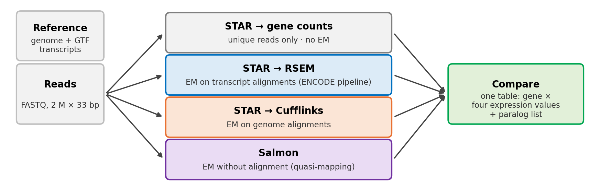
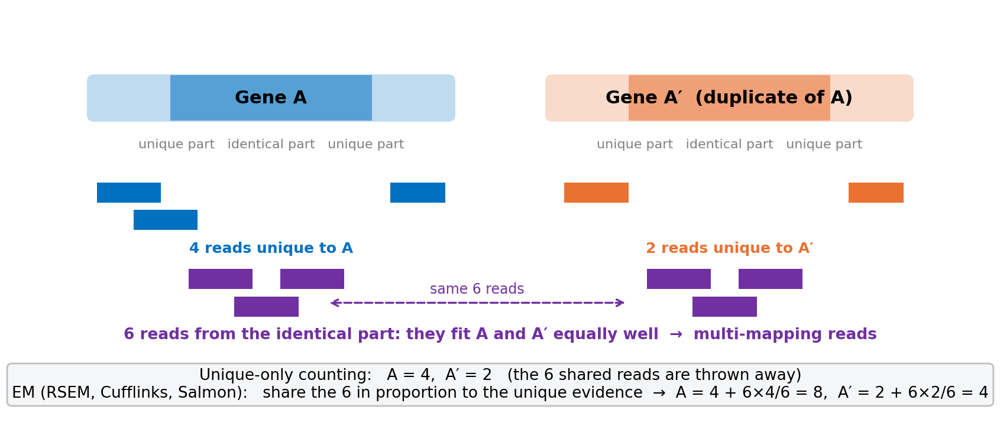

::: {.callout-important appearance="simple"}
**The question.** Qian, Liao, Chang & Zhang (2010, *Trends in Genetics*) found that **duplicate genes are expressed at lower levels** than single-copy genes, and proposed that this is *why* duplicates are kept. Their yeast numbers came from RNA-seq reads that were counted **only when they mapped to a unique place** in the genome. Duplicate genes are similar to each other, so many of their reads map to *both* copies and are thrown away by that rule. Today you quantify the **same yeast reads** four ways, three of them with the EM algorithm from Lecture 7, and decide whether the conclusion depends on the tool. **Part A** runs the four tools in a **Google Colab** notebook (Run all, about 20 minutes; Galaxy is the backup). **Part B**, the comparison, is in the same notebook, and also on this page in Python or R using the instructor's results. The [handout](downloads/DATA405_Lab4_Handout.pdf) ([Word](downloads/DATA405_Lab4_Handout.docx)) explains every step and has the report questions. **Report due Tuesday, Nov 3, 11:59 pm on Canvas.**
:::

{width=100%}

| Part | What you do | Where | Time |
|---|---|---|---|
| **A** | Install the tools, download reads + reference, run STAR → RSEM, Cufflinks, Salmon | Colab notebook (Run all) | ≈ 20 min, all waiting: read A1 meanwhile |
| **B** | Join the four results with the duplicate-gene table; look at TEF1/TEF2; test the paper's conclusion | same notebook (Python), or this page (Python or R) | ≈ 40 min |

**The paper.** [Qian, Liao, Chang & Zhang 2010, *Trends in Genetics* 26: 425–430 (PDF)](downloads/Qian_2010_TiG_duplicate_genes.pdf) · [Supplementary Methods (PDF)](downloads/Qian_2010_TiG_supplementary_methods.pdf) — read the first two pages and the Supplementary Methods paragraph on how the yeast expression levels were obtained.

**Data.** The reads are the real yeast RNA-seq reads Qian et al. used (Nagalakshmi et al. 2008, *Science*; run SRR002051, Illumina 2008, 33 bp, single-end), subsampled to 2 million. Reference: *S. cerevisiae* R64 genome, gene annotation and transcripts (Ensembl Fungi 63). Duplicate genes: Ensembl paralogues with the protein identity of the closest paralog.

{width=90%}

## Part A · Four quantifications in Colab

<a class="btn btn-primary" href="https://colab.research.google.com/github/compbio-geb/DATA405_2026/blob/main/notebooks/Lab4_RNAseq_Quantification.ipynb" target="_blank">Open the Lab 4 notebook in Colab</a>

**File → Save a copy in Drive**, then **Runtime → Run all**. While it runs (about 20 minutes), read the handout's Section A1. The notebook:

| Step | Command (core) | What it does | Output you need |
|---|---|---|---|
| 1 | `apt-get install rna-star rsem salmon cufflinks` | installs the four tools | versions |
| 2 | `wget …/data/lab4/…` | reads (2 M × 33 bp), genome, GTF, transcripts, paralog table | — |
| 3 | `STAR … --quantMode TranscriptomeSAM GeneCounts` | maps reads; **unique reads per gene** (no EM) + transcriptome BAM | `star_Log.final.out`, `star_ReadsPerGene.out.tab` |
| 4 | `rsem-calculate-expression --alignments …` | EM on the transcriptome BAM (ENCODE pipeline) | `rsem.genes.results` |
| 5 | `cufflinks -G genes.gtf …` | multi-reads split evenly, EM across isoforms | `cufflinks/genes.fpkm_tracking` |
| 6 | `salmon quant -k 19 -g genes.gtf …` | k-mer quasi-mapping + EM | `salmon/quant.genes.sf` |

**You should see** in the STAR log: 2,000,000 input reads · uniquely mapped 51.3 % · multi-mapped 6.8 % (135,672 reads) · too many loci 2.0 % · unmapped (too short) 39.3 %. Salmon's mapping rate is about 29 %.

## Part B · Compare the four answers

The notebook already contains Exercises 1–5 in Python. The same analysis is here for R users, or if Colab is slow; it loads the instructor's four result tables (same files, same settings as Part A) and the duplicate-gene table, and joins them into one table `d` with one row per gene.

::: {.two-col}
::: {}
<span class="lang-tag py">Python</span>
```{.pyodide}
import numpy as np
import pandas as pd
import matplotlib.pyplot as plt
D = "data/lab4_results/"

star = pd.read_csv(D + "star_reads_per_gene.tab", sep="\t", header=None,
                   names=["gene", "count", "fwd", "rev"])
special = star[star.gene.str.startswith("N_")]           # the N_ summary rows
star = star[~star.gene.str.startswith("N_")][["gene", "count"]].rename(columns={"count": "STAR"})
rsem = (pd.read_csv(D + "rsem_genes.results", sep="\t")[["gene_id", "expected_count", "TPM"]]
          .rename(columns={"gene_id": "gene", "expected_count": "RSEM", "TPM": "RSEM_TPM"}))
cuff = (pd.read_csv(D + "cufflinks_genes.fpkm_tracking", sep="\t")[["tracking_id", "FPKM"]]
          .rename(columns={"tracking_id": "gene", "FPKM": "Cufflinks_FPKM"}))
salmon = (pd.read_csv(D + "salmon_quant_genes.sf", sep="\t")[["Name", "NumReads", "TPM"]]
            .rename(columns={"Name": "gene", "NumReads": "Salmon", "TPM": "Salmon_TPM"}))
par = pd.read_csv(D + "yeast_paralogs.tsv", sep="\t")

d = (star.merge(rsem, on="gene").merge(cuff, on="gene", how="left").merge(salmon, on="gene", how="left")
         .merge(par[["gene", "name", "closest_paralog", "min_pct_id"]], on="gene", how="left"))
d["identity"] = pd.cut(d.min_pct_id.fillna(0), [-1, 30, 70, 95, 101],
                       labels=["no close paralog", "30-70 %", "70-95 %", "95-100 %"])
print(special.to_string(index=False))
print(len(d), "genes;", d.min_pct_id.notna().sum(), "have a paralog")
```
:::
::: {}
<span class="lang-tag r">R</span>
```{.webr}
D <- "data/lab4_results/"

star <- read.delim(paste0(D, "star_reads_per_gene.tab"), header = FALSE,
                   col.names = c("gene", "count", "fwd", "rev"))
special <- star[grepl("^N_", star$gene), ]                 # the N_ summary rows
star <- star[!grepl("^N_", star$gene), c("gene", "count")]; names(star)[2] <- "STAR"
rsem <- read.delim(paste0(D, "rsem_genes.results"))[, c("gene_id", "expected_count", "TPM")]
names(rsem) <- c("gene", "RSEM", "RSEM_TPM")
cuff <- read.delim(paste0(D, "cufflinks_genes.fpkm_tracking"))[, c("tracking_id", "FPKM")]
names(cuff) <- c("gene", "Cufflinks_FPKM")
salmon <- read.delim(paste0(D, "salmon_quant_genes.sf"))[, c("Name", "NumReads", "TPM")]
names(salmon) <- c("gene", "Salmon", "Salmon_TPM")
par <- read.delim(paste0(D, "yeast_paralogs.tsv"))

d <- merge(star, rsem, by = "gene")
d <- merge(d, cuff, by = "gene", all.x = TRUE)
d <- merge(d, salmon, by = "gene", all.x = TRUE)
d <- merge(d, par[, c("gene", "name", "closest_paralog", "min_pct_id")], by = "gene", all.x = TRUE)
d$identity <- cut(ifelse(is.na(d$min_pct_id), 0, d$min_pct_id), c(-1, 30, 70, 95, 101),
                  labels = c("no close paralog", "30-70 %", "70-95 %", "95-100 %"))
print(special, row.names = FALSE)
cat(nrow(d), "genes;", sum(!is.na(d$min_pct_id)), "have a paralog\n")
```
:::
:::

## Exercise 1 · How many reads did each tool use? (5 min)

STAR's table starts with four `N_` rows: unmapped, multi-mapping, no feature (mapped outside any gene), ambiguous (inside two overlapping genes). Only *uniquely* mapped reads inside one gene are counted for genes. Add up what each tool assigned to genes.

::: {.two-col}
::: {}
<span class="lang-tag py">Python</span>
```{.pyodide}
#| exercise: ex1_py
#| envir: global
print("STAR, unique reads in genes:", int(d.STAR.sum()))
print("RSEM, expected counts      :", int(d.RSEM.sum()))
print("Salmon, reads              :", int(d.Salmon.sum()))
print("multi-mapping reads STAR threw away:", int(special.loc[special.gene == "______", "count"].iloc[0]))
```

::: {.hint exercise="ex1_py"}
::: {.callout-tip collapse="false"}
## Hint
The row is called `N_multimapping`.
:::
:::

::: {.solution exercise="ex1_py"}
```python
print("STAR, unique reads in genes:", int(d.STAR.sum()))            # 681,891
print("RSEM, expected counts      :", int(d.RSEM.sum()))            # 726,466
print("Salmon, reads              :", int(d.Salmon.sum()))          # 584,107
print("multi-mapping reads STAR threw away:", int(special.loc[special.gene == "N_multimapping", "count"].iloc[0]))  # 135,672
```
:::
:::
::: {}
<span class="lang-tag r">R</span>
```{.webr}
#| exercise: ex1_r
#| envir: global
cat("STAR, unique reads in genes:", sum(d$STAR), "\n")
cat("RSEM, expected counts      :", round(sum(d$RSEM)), "\n")
cat("Salmon, reads              :", round(sum(d$Salmon, na.rm = TRUE)), "\n")
cat("multi-mapping reads STAR threw away:", special$count[special$gene == "______"], "\n")
```

::: {.hint exercise="ex1_r"}
::: {.callout-tip collapse="false"}
## Hint
The row is called `N_multimapping`.
:::
:::

::: {.solution exercise="ex1_r"}
```r
cat("STAR, unique reads in genes:", sum(d$STAR), "\n")              # 681,891
cat("RSEM, expected counts      :", round(sum(d$RSEM)), "\n")       # 726,466
cat("Salmon, reads              :", round(sum(d$Salmon, na.rm = TRUE)), "\n")   # 584,107
cat("multi-mapping reads STAR threw away:", special$count[special$gene == "N_multimapping"], "\n")  # 135,672
```
:::
:::

## Exercise 2 · One duplicate pair: TEF1 and TEF2 (10 min)

*TEF1* (YPR080W) and *TEF2* (YBR118W) encode translation elongation factor 1α. Their proteins are **100 % identical** and their coding sequences differ at only a handful of positions. Look them up in all four results, then do the same for *TDH3*/*TDH2* (96 % identical) and *ADH1*/*ADH2* (93 %).

::: {.two-col}
::: {}
<span class="lang-tag py">Python</span>
```{.pyodide}
#| exercise: ex2_py
#| envir: global
cols = ["gene", "name", "closest_paralog", "min_pct_id", "STAR", "RSEM", "Cufflinks_FPKM", "Salmon"]
pairs = ["YPR080W", "YBR118W", "YGR192C", "YJR009C", "YOL086C", "______"]
print(d[d.gene.isin(pairs)][cols].round(1).to_string(index=False))
```

::: {.hint exercise="ex2_py"}
::: {.callout-tip collapse="false"}
## Hint
*ADH2* is YMR303C (it is the `closest_paralog` listed for YOL086C).
:::
:::

::: {.solution exercise="ex2_py"}
```python
cols = ["gene", "name", "closest_paralog", "min_pct_id", "STAR", "RSEM", "Cufflinks_FPKM", "Salmon"]
pairs = ["YPR080W", "YBR118W", "YGR192C", "YJR009C", "YOL086C", "YMR303C"]
print(d[d.gene.isin(pairs)][cols].round(1).to_string(index=False))
# TEF1: STAR 768 · RSEM 7,006 · Cufflinks 4,957 FPKM · Salmon 5,585      TEF2: 859 · 6,218 · 4,931 · 4,614
# TDH3: 9,111 · 15,613 · 11,719                   TDH2: 2,637 · 4,891 · 3,490
```
:::
:::
::: {}
<span class="lang-tag r">R</span>
```{.webr}
#| exercise: ex2_r
#| envir: global
cols <- c("gene", "name", "closest_paralog", "min_pct_id", "STAR", "RSEM", "Cufflinks_FPKM", "Salmon")
pairs <- c("YPR080W", "YBR118W", "YGR192C", "YJR009C", "YOL086C", "______")
print(d[d$gene %in% pairs, cols], row.names = FALSE, digits = 4)
```

::: {.hint exercise="ex2_r"}
::: {.callout-tip collapse="false"}
## Hint
*ADH2* is YMR303C (it is the `closest_paralog` listed for YOL086C).
:::
:::

::: {.solution exercise="ex2_r"}
```r
cols <- c("gene", "name", "closest_paralog", "min_pct_id", "STAR", "RSEM", "Cufflinks_FPKM", "Salmon")
pairs <- c("YPR080W", "YBR118W", "YGR192C", "YJR009C", "YOL086C", "YMR303C")
print(d[d$gene %in% pairs, cols], row.names = FALSE, digits = 4)
# TEF1: STAR 768 · RSEM 7006 · Cufflinks 4957 FPKM · Salmon 5585      TEF2: 859 · 6218 · 4931 · 4614
```
:::
:::

## Exercise 3 · From one pair to all genes (15 min)

For every gene with at least 20 RSEM reads, compute the **gain** = RSEM count ÷ STAR unique count: how many times more reads EM gives than unique-only counting. Summarise it by how similar the gene is to its closest paralog.

::: {.two-col}
::: {}
<span class="lang-tag py">Python</span>
```{.pyodide}
#| exercise: ex3_py
#| envir: global
e = d[d.RSEM >= 20].copy()
e["gain"] = e.RSEM / e.STAR.clip(lower=1)
summary = e.groupby("identity", observed=True).gain.agg(
    n="size", median="median", q75=lambda x: x.quantile(0.75),
    share_over_1_5=lambda x: (x > ______).mean())
print(summary.round(2))

fig, ax = plt.subplots(figsize=(6, 4))
e.boxplot(column="gain", by="identity", ax=ax, showfliers=False)
ax.set_yscale("log"); ax.set_ylabel("RSEM / STAR unique"); ax.set_xlabel("protein identity to closest paralog")
ax.set_title(""); fig.suptitle(""); plt.show()
```

::: {.hint exercise="ex3_py"}
::: {.callout-tip collapse="false"}
## Hint
Count the genes whose gain is above 1.5 (EM gives at least 50 % more reads).
:::
:::

::: {.solution exercise="ex3_py"}
```python
e = d[d.RSEM >= 20].copy()
e["gain"] = e.RSEM / e.STAR.clip(lower=1)
summary = e.groupby("identity", observed=True).gain.agg(
    n="size", median="median", q75=lambda x: x.quantile(0.75),
    share_over_1_5=lambda x: (x > 1.5).mean())
print(summary.round(2))
# no close paralog: n 3398, median 0.91, 5 % over 1.5 · 30-70 %: 0.92, 2 % · 70-95 %: 0.95, 11 % · 95-100 %: n 143, median 1.28, q75 3.4, 43 % over 1.5
```
:::
:::
::: {}
<span class="lang-tag r">R</span>
```{.webr}
#| exercise: ex3_r
#| envir: global
e <- d[d$RSEM >= 20, ]
e$gain <- e$RSEM / pmax(e$STAR, 1)
summary <- aggregate(gain ~ identity, e, function(x)
  c(n = length(x), median = median(x), q75 = quantile(x, 0.75), share_over_1_5 = mean(x > ______)))
print(summary, digits = 3)

boxplot(gain ~ identity, e, log = "y", outline = FALSE,
        xlab = "protein identity to closest paralog", ylab = "RSEM / STAR unique")
```

::: {.hint exercise="ex3_r"}
::: {.callout-tip collapse="false"}
## Hint
Count the genes whose gain is above 1.5 (EM gives at least 50 % more reads).
:::
:::

::: {.solution exercise="ex3_r"}
```r
e <- d[d$RSEM >= 20, ]
e$gain <- e$RSEM / pmax(e$STAR, 1)
summary <- aggregate(gain ~ identity, e, function(x)
  c(n = length(x), median = median(x), q75 = quantile(x, 0.75), share_over_1_5 = mean(x > 1.5)))
print(summary, digits = 3)
# 95-100 %: n 143, median 1.28, q75 3.4, 43 % over 1.5; all other groups: median ≈ 0.9, ≤ 11 % over 1.5
```
:::
:::

## Exercise 4 · The paper's test, with and without EM (15 min)

Qian et al. compared the **two copies together** with the single ancestral gene and found that about 31 % more duplicate pairs than expected looked reduced. The ancestral gene is not in our data, but we can ask the question that matters: *how much of a duplicate pair's expression disappears when only unique reads are counted?* For each pair, lost = 1 − (STAR₁ + STAR₂) / (RSEM₁ + RSEM₂).

::: {.two-col}
::: {}
<span class="lang-tag py">Python</span>
```{.pyodide}
#| exercise: ex4_py
#| envir: global
p = d.dropna(subset=["closest_paralog"]).merge(
        d[["gene", "STAR", "RSEM"]].rename(columns={"gene": "closest_paralog", "STAR": "STAR2", "RSEM": "RSEM2"}),
        on="closest_paralog")
p = p[p.gene < p.closest_paralog]                       # keep each pair once
p = p[(p.RSEM + p.RSEM2) >= 40]
p["lost"] = 1 - (p.STAR + p.STAR2) / (p.RSEM + p.RSEM2)
p["identity"] = pd.cut(p.min_pct_id, [0, 70, 95, 101], labels=["<70 %", "70-95 %", "95-100 %"])
print(p.groupby("identity", observed=True).lost.agg(n="size", median="median",
      share_over_31=lambda x: (x > ______).mean()).round(2))
print(p.sort_values("lost", ascending=False)[["gene", "name", "closest_paralog", "min_pct_id", "STAR", "STAR2", "RSEM", "RSEM2", "lost"]].head(6).round(2).to_string(index=False))
```

::: {.hint exercise="ex4_py"}
::: {.callout-tip collapse="false"}
## Hint
The paper's excess was 31 %, so test `x > 0.31`.
:::
:::

::: {.solution exercise="ex4_py"}
```python
# ... same code with (x > 0.31)
# <70 %: 1,124 pairs, median lost −0.09, 2 % over 31 % · 70-95 %: 90 pairs, −0.06, 12 % · 95-100 %: 70 pairs, median 0.19, 43 % over 31 %
# top: CUP1-1/CUP1-2, ASP3-1..4 (100 % identical, no unique reads at all: lost = 100 %), then EFT2/EFT1 89 %, TEF2/TEF1 88 %
```
:::
:::
::: {}
<span class="lang-tag r">R</span>
```{.webr}
#| exercise: ex4_r
#| envir: global
p <- d[!is.na(d$closest_paralog), ]
p2 <- d[, c("gene", "STAR", "RSEM")]; names(p2) <- c("closest_paralog", "STAR2", "RSEM2")
p <- merge(p, p2, by = "closest_paralog")
p <- p[p$gene < p$closest_paralog, ]                    # keep each pair once
p <- p[(p$RSEM + p$RSEM2) >= 40, ]
p$lost <- 1 - (p$STAR + p$STAR2) / (p$RSEM + p$RSEM2)
p$identity <- cut(p$min_pct_id, c(0, 70, 95, 101), labels = c("<70 %", "70-95 %", "95-100 %"))
print(aggregate(lost ~ identity, p, function(x) c(n = length(x), median = median(x), share_over_31 = mean(x > ______))), digits = 2)
top <- p[order(-p$lost), c("gene", "name", "closest_paralog", "min_pct_id", "STAR", "STAR2", "RSEM", "RSEM2", "lost")]
print(head(top, 6), row.names = FALSE, digits = 3)
```

::: {.hint exercise="ex4_r"}
::: {.callout-tip collapse="false"}
## Hint
The paper's excess was 31 %, so test `x > 0.31`.
:::
:::

::: {.solution exercise="ex4_r"}
```r
# ... same code with mean(x > 0.31)
# 95-100 %: 70 pairs, median lost 0.19, 43 % of pairs lose more than 31 %; <70 %: 2 %
```
:::
:::

## Exercise 5 · Do the three EM tools agree? (10 min)

Plot RSEM against Salmon, and RSEM against STAR, on log axes, colouring the 95–100 % group.

::: {.two-col}
::: {}
<span class="lang-tag py">Python</span>
```{.pyodide}
#| exercise: ex5_py
#| envir: global
fig, axes = plt.subplots(1, 2, figsize=(10, 4.3))
for ax, x, lab in [(axes[0], "STAR", "STAR unique reads"), (axes[1], "Salmon", "Salmon reads")]:
    close = e.identity == "95-100 %"
    ax.scatter(e[x][~close] + 1, e.RSEM[~close] + 1, s=4, alpha=.3, color="grey")
    ax.scatter(e[x][close] + 1, e.RSEM[close] + 1, s=8, color="#C00000", label="paralog 95-100 % identical")
    ax.plot([1, 3e4], [1, 3e4], "k--", lw=1); ax.set_xscale("log"); ax.set_yscale("log")
    ax.set_xlabel(lab); ax.set_ylabel("RSEM expected count"); ax.legend(loc="upper left")
    r = np.corrcoef(np.log10(e[x] + 1), np.log10(e.RSEM + 1))[0, 1]
    ax.set_title(f"correlation of log counts: r = {r:.3f}")
plt.tight_layout(); plt.show()
print("Cufflinks FPKM vs RSEM TPM, r =", round(np.corrcoef(np.log10(e.Cufflinks_FPKM.fillna(0) + 1), np.log10(e.RSEM_TPM + 1))[0, 1], 3))
```
:::
::: {}
<span class="lang-tag r">R</span>
```{.webr}
#| exercise: ex5_r
#| envir: global
par(mfrow = c(1, 2))
close <- e$identity == "95-100 %"
for (x in c("STAR", "Salmon")) {
  plot(e[[x]] + 1, e$RSEM + 1, log = "xy", pch = 16, cex = .3, col = "grey",
       xlab = paste(x, "reads"), ylab = "RSEM expected count")
  points(e[[x]][close] + 1, e$RSEM[close] + 1, pch = 16, cex = .5, col = "#C00000")
  abline(0, 1, lty = 2)
  r <- cor(log10(e[[x]] + 1), log10(e$RSEM + 1), use = "complete.obs")
  title(sprintf("r = %.3f (log counts)", r))
}
cat("Cufflinks FPKM vs RSEM TPM, r =", round(cor(log10(ifelse(is.na(e$Cufflinks_FPKM), 0, e$Cufflinks_FPKM) + 1), log10(e$RSEM_TPM + 1)), 3), "\n")
```
:::
:::

## Report questions (5 points)

See the handout: **Q1** read fate from the STAR log · **Q2** your own Galaxy numbers for TEF1, TEF2 and TDH3 in all four tools, next to the page's · **Q3** why TEF1 gains 9× under EM but ADH1 does not · **Q4** how EM decides how to share the reads (Lecture 7) · **Q5** Qian's pipeline and which of their duplicate pairs it could misjudge · **Q6** does the conclusion survive? · **Q7** what changes with 150-bp reads. Include your box plot (Ex 3) and one scatter (Ex 5).

## Appendix · The same four quantifications in Galaxy (backup)

If Colab is unavailable, the same pipeline runs by clicking in Galaxy. Use **usegalaxy.eu** (it has RSEM; usegalaxy.org has the other three). Sign in, then make a new history (＋ in the history panel) called *Lab 4*. The settings below were checked on Oct 27 and give the same numbers as the notebook.

::: {.panel-tabset}

### 1 · Upload (4 files)

**Upload → Paste/Fetch data**, paste all four addresses (one per line), set **Type** as shown, click **Start**:

```
https://compbio-geb.github.io/DATA405_2026/data/lab4/yeast_reads_2M.fastq.gz
https://compbio-geb.github.io/DATA405_2026/data/lab4/yeast_genome_R64.fa
https://compbio-geb.github.io/DATA405_2026/data/lab4/yeast_genes_R64.gtf
https://compbio-geb.github.io/DATA405_2026/data/lab4/yeast_transcripts_R64.fa
```

| File | Type to set | What it is |
|---|---|---|
| yeast_reads_2M.fastq.gz | `fastqsanger.gz` | 2,000,000 reads, 33 bp |
| yeast_genome_R64.fa | `fasta` | 16 chromosomes + mitochondrion (12 MB) |
| yeast_genes_R64.gtf | `gtf` | 7,127 genes, one transcript each (10 MB) |
| yeast_transcripts_R64.fa | `fasta` | the 7,127 transcript sequences (9 MB) |

**You should see:** four green datasets (reads ≈ 73 MB).

### 2 · STAR

Tool **RNA STAR**. Settings: single-end · reads = dataset 1 · *Custom or built-in reference genome:* **Use reference genome from history** · genome = dataset 2 · *Length of the SA pre-indexing string:* **10** · *Build index with or without known splice junctions annotation:* **with gene-model** · gene model = dataset 3 · *Length of the genomic sequence around annotated junctions:* **32** · *Per gene/transcript output:* **Per gene read counts and transcriptome BAM (TranscriptomeSAM GeneCounts)**. Run.

**You should see** five outputs: log, splice junctions, *mapped.bam*, *transcriptome-mapped.bam*, *reads per gene*. Open the **log**: 2,000,000 input reads · uniquely mapped ≈ 51 % · multi-mapped ≈ 7 % · "too many loci" ≈ 2 % · unmapped ≈ 39 % (these 2008 reads have poor 3′ ends). ✏️ Write those four numbers down.

### 3 · RSEM

Tool **RSEM calculate expression** (version 1.3.3). *Transcriptome alignments* = STAR's **transcriptome-mapped.bam** · *Reference sequences:* **genome** · *Genome source:* **history** → dataset 2 · *Gene annotation* = dataset 3 · *Library layout:* **single**. Run.

**You should see:** *gene expression* and *isoform expression* tables. Columns: `gene_id, transcript_id(s), length, effective_length, expected_count, TPM, FPKM`.

### 4 · Cufflinks

Tool **Cufflinks**. Input = STAR's **mapped.bam** · *Use Reference Annotation:* **Use reference annotation** → dataset 3 · leave *Use multi-read correct* at **No**. Run.

**You should see:** *gene expression* (columns include `tracking_id`, `gene_id`, `FPKM`), *transcript expression*, and *assembled transcripts*.

### 5 · Salmon

Tool **Salmon quant**. *Select a reference transcriptome from your history:* dataset 4 · *Kmer size:* **19** · single-end · reads = dataset 1 · *library type:* **U** · *File containing a mapping of transcripts to genes:* dataset 3. Run.

**You should see:** *gene quantification* (`Name, Length, EffectiveLength, TPM, NumReads`) and *transcript quantification*. The log reports a mapping rate ≈ 30 %.

### Fallback

If uploads or jobs are slow on usegalaxy.eu, switch to **usegalaxy.org** (same steps; it has everything except RSEM — take the RSEM values from the page for Q2 and say so). If a job is stuck, continue with Part B: the page loads the instructor's four results (same data, same settings). Finish Part A later and check three genes against the page (Q2).

:::

